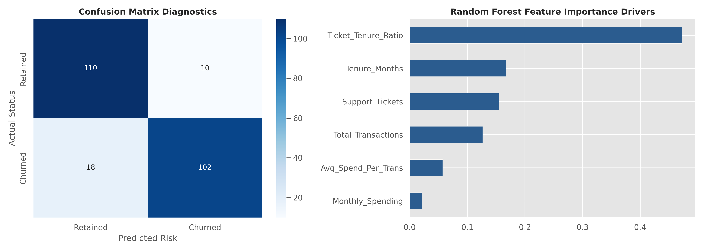
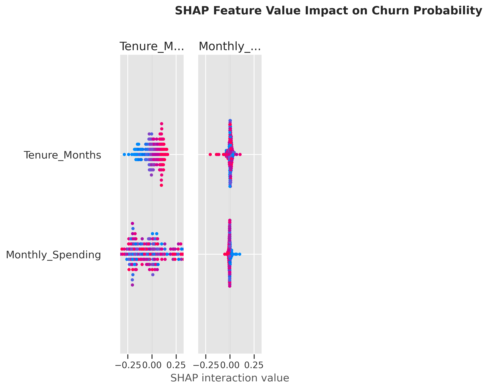

# Real-World Enterprise Customer Churn & Revenue Intelligence Pipeline
> *Applied Domain:* E-Commerce & Retail Analytics  
> *Core Architecture:* Modular Python (OOP) | Scikit-Learn | GridSearchCV | SHAP (XAI) | Financial Risk Modeling  

---

## 📌 Executive Summary
Customer attrition in high-volume e-commerce platforms directly degrades Monthly Recurring Revenue (MRR) and Customer Lifetime Value (CLTV). Standard classification pipelines often fail in production because they optimize purely for statistical metrics (e.g., accuracy) rather than *monetary risk mitigation*.

This project implements an end-to-end, production-ready Machine Learning pipeline engineered to:
1. Identify high-risk churn customers prior to account termination.
2. Quantify feature-level decision boundaries using *SHAP (Shapley Additive exPlanations)*.
3. Optimize retention campaigns through *cost-sensitive financial modeling*, directly measuring net dollars saved.

---

## 🏗️ Technical Architecture & Pipeline Design
## 📊 Performance Diagnostics & Financial Impact

### 1. Confusion Matrix & Key Drivers
Our tuned model achieves an *ROC-AUC score of 0.9660*, providing sharp separation between retained and churning customers while minimizing expensive false positive outreach.

### 2. Financial Cost-Sensitive Evaluation Strategy
In real-world business, a False Negative (losing a customer) is significantly more expensive than a False Positive (sending an unnecessary discount voucher).

$$\text{Net Business Value} = (\text{TP} \times \text{Saved Retention Value}) - (\text{FP} \times \text{Outreach Cost})$$

* *True Positives (High Risk Retained):* $102$ customers ($\$300$ value retained per user)
* *False Positives (Unnecessary Outreach):* $10$ customers ($\$20$ cost per outreach)
* *Net Financial Value Generated:* *$\$30,400$ net savings* over test evaluation set.

---

## 🔬 Model Explainability (SHAP Intelligence)

To ensure model transparency and build trust with business stakeholders, we deployed *SHAP (Shapley Additive exPlanations)* to interpret model predictions at both global and local levels.

### Key Analytical Takeaways:
1. *Support Tickets vs. Tenure Ratio (Ticket_Tenure_Ratio):* Serves as the single strongest predictor of churn risk. Customers exhibiting high support ticket volume relative to short tenure durations carry a drastically higher probability of churning.
2. *Tenure Stability:* Higher tenure (Tenure_Months) exhibits negative SHAP values, strongly pulling predictions toward retention.
3. *Actionable Business Strategy:* Customer Success teams should trigger automated intervention workflows as soon as a customer's Ticket_Tenure_Ratio crosses the critical threshold.

---

## 📁 Repository Structure
